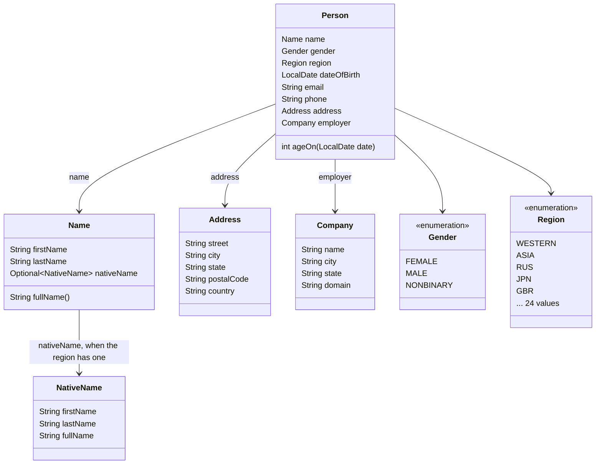

# Introduction
This project was vibe coded in around eight hours over the course of two days using the <a href="https://github.com/SanvioLabs/sanvio-factory">SanvioLabs Factory</a> harness with Claude Code. This was the initial prompt:
```text
I need a reusable CLI tool to generate random, _believable_ "person" data that I can pipe to another application. Write it in java.
````
I didn't have to write any code, and only made a few hand changes when prompted to do so. Everything outside of this introduction, including the <a href="https://github.com/tauasa/faux-person-fx">JavaFX desktop application</a>, <a href="https://github.com/tauasa/faux-person-web">faux-person-web webapp</a>, was created with Claude + <a href="https://github.com/SanvioLabs/sanvio-factory">SanvioLabs Factory</a> using VS Code (I didn't even have to open a shell).

You can try out the <a href="https://github.com/tauasa/faux-person-web">faux-person-web</a> webapp instance running here: https://apps.tauasa.org/faux-person-web.

Feedback and comments are welcome, or just submit a pull request.

# faux-person

A Java library and command-line tool that generates random, realistic people
for tests, demos and seed data. Each person has a name, gender, date of birth,
email, phone, US street address and employer, and the fields agree with each
other: the email is built from the name and the employer, a woman with
a Russian surname gets the feminine form (Petrova, not Petrov), and the age
fits the date of birth. Names come up about as often as they do in real life:
about one South Korean in five is a Kim, and so is about one generated one,
and Aleksandr is the most common name for a Russian man.

Give it a seed and you get the same people every time, so a failing test can
be replayed exactly. Birth dates count back from today, so fix the date too
(`--today` on the command line, `.clock(...)` in Java) when you need the same
birth dates on another day. It has no runtime dependencies.

Names and companies can also be generated on their own, with `NameGenerator`
and `CompanyGenerator` in Java or `faux-name.sh` and `faux-company.sh` on the
command line.

```text
$ ./faux-person.sh -n 3 --seed 42 --today 2026-11-20
Juha Karvonen (male, 63) <juha.karvonen@morganstanley.example> (319) 555-0128, 9694 W 6th Ave, Humboldt, SD 57035, works at Morgan Stanley [faux]
Jose Barra (male, 36) <jose.barra48@fourwaybooks.example> (260) 555-0158, 8418 Golden Aster Ct, Noblesville, IN 46062, works at Four Way Books [faux]
Jens Klausen (male, 73) <jens.klausen@catabasis.example> (959) 555-0112, 4859 Page St, Manchester, NH 03109, works at Catabasis Pharmaceuticals [faux]
```

> **Emails and phone numbers can't reach anyone.** Employers are real US
> companies, marked so nobody mistakes them for a real person's employer: the
> name ends in `[faux]` and the domain is under `.example`, which is reserved
> so mail to it is never delivered (`Costco [faux]`, `jane.doe@costco.example`). Phone
> numbers are always in the 555-0100 to 555-0199 range, which is reserved for
> fiction. Addresses use real streets with a random house number, so one can
> match a real home: don't mail anything to a generated address.
>
> `--real-companies`, or `.realCompanies(true)` in Java, drops the marks and
> uses the real names and domains (`Costco`, `jane.doe@costco.com`). An email
> like that can be someone's real inbox, so never send to one.

## The model



*Figure: a `Person` holds a `Name`, a `Gender`, a `Region`, an `Address` and
an employer `Company`. A South Korean's `Name` also holds a `NativeName` in
Hangul. All seven types are in `org.tauasa.faux.model`. `Person`, `Name`,
`NativeName`, `Address` and `Company` are immutable records, and `Gender` and
`Region` are enums. In `org.tauasa.faux`, `PersonGenerator` creates people,
`NameGenerator` names and `CompanyGenerator` companies.*

| Type | What it holds |
|---|---|
| `Person` | Name, gender, the region the names came from, date of birth, email, phone, address and employer. There's no age field, because a stored age goes stale: call `ageOn(date)`. `firstName()` and `lastName()` are shortcuts for `name().firstName()` and `name().lastName()` |
| `Name` | A first name and a surname from one region, in Latin letters, the surname in the form that fits the gender (`Anna Petrova`). `fullName()` gives `"Anna Petrova"`. `nativeName()` gives the name in its own script where the region's data has one, and is empty otherwise. Today only `ROK` does |
| `NativeName` | The name in its own script: first name, surname, and the full name as that language writes it. For `Yeong-min Kim` it's `영민`, `김` and `김영민`, surname first with no space |
| `Address` | Street with house number (`2304 Eileen Ave`), city, two-letter state, five-digit ZIP, and country, always `US` |
| `Company` | A US company: name, headquarters city and state, and web domain, which the email uses. Generated ones are real companies, marked by default (`Costco [faux]`, `costco.example`) |
| `Gender` | `FEMALE`, `MALE` or `NONBINARY`. Women get women's and unisex first names and the feminine surname form, men get men's and unisex names and the masculine form. A nonbinary person gets a woman's or a man's first name at 50/50, and either surname form at 50/50 |
| `Region` | Where the names come from, in 24 values. Three broad ones: `WESTERN` (the Americas, Europe, Australia, New Zealand), `ASIA` (East, South and Southeast Asia) and `RUS` (Russia and the former Soviet Union). Three African: `NAF`, `CAF`, `SAF` (North, Central and Southern Africa). The rest are countries, by ISO code: `ROK` (South Korea), `JPN`, `PHL`, `VNM`, `THA`, `MEX`, `BRA`, `IRN`, `PSE`, `GBR`, `FRA`, `ESP`, `PRT`, `GRC`, `NOR`, `SWE`, `FIN`. The odd one out is `HEB`, which holds Hebrew names, from Israeli citizens |

Every record rejects `null` fields.

## Use it in a Java project

The artifact is on Maven Central. Add it to your project (usually in _test_ scope):

```xml
<dependency>
  <groupId>org.tauasa</groupId>
  <artifactId>faux-person</artifactId>
  <version>0.2.0</version>
  <scope>test</scope>
</dependency>
```

Generate people:

```java
import java.time.LocalDate;
import java.util.List;
import org.tauasa.faux.PersonGenerator;
import org.tauasa.faux.model.Person;
import org.tauasa.faux.model.Region;

PersonGenerator gen = PersonGenerator.builder()
        .seed(42)                    // optional: the same seed gives the same people
        .region(Region.ASIA)         // optional: default picks a region per person
        .ageRange(25, 40)            // optional: default 18 to 90, inclusive
        .genderWeights(50, 50, 0)    // optional: FEMALE, MALE, NONBINARY (default 49, 49, 2)
        .realCompanies(false)        // optional: true for real employer names and email domains
        .build();

Person p = gen.next();
List<Person> team = gen.next(20);
List<Person> adults = gen.stream().filter(x -> x.ageOn(LocalDate.now()) >= 21).limit(100).toList();
```

To replay a failure, log `gen.seed()` and pass it back to `.seed(...)`. That
works even if you didn't set a seed, because the generator reports the random
one it picked. Pass `.clock(Clock.fixed(...))` too if a test checks ages, so
"today" doesn't move.

A generator isn't thread-safe. Give each thread its own with `gen.split()`,
which keeps the settings and starts a separate sequence you can replay.
Splitting draws from the parent, so it changes the parent's later people too:
to replay a run, call `split()` at the same points.

`build()` throws `IllegalArgumentException` if the age range falls outside
0 to 120 or is reversed, or if the gender weights are negative or all zero.

### Names and companies on their own

`NameGenerator` and `CompanyGenerator` work like `PersonGenerator`: a builder,
`next()`, `next(n)`, `stream()`, `seed()` and `split()`, and the same seed
gives the same results. They're new in 0.2.0.

```java
import org.tauasa.faux.CompanyGenerator;
import org.tauasa.faux.NameGenerator;
import org.tauasa.faux.model.Company;
import org.tauasa.faux.model.Name;
import org.tauasa.faux.model.NativeName;
import org.tauasa.faux.model.Region;

NameGenerator names = NameGenerator.builder()
        .seed(42)                    // optional
        .region(Region.RUS)          // optional: default picks a region per name
        .genderWeights(1, 0, 0)      // optional: women's names only (default 49, 49, 2)
        .build();
Name n = names.next();               // Elena Nikitina
String full = n.fullName();          // "Elena Nikitina"

Name k = NameGenerator.builder().seed(42).region(Region.ROK).build().next();
String hangul = k.nativeName().map(NativeName::fullName).orElse("");   // "김영민" for Yeong-min Kim

CompanyGenerator companies = CompanyGenerator.builder()
        .seed(42)                    // optional
        .realCompanies(false)        // optional: true for real names and domains
        .build();
Company c = companies.next();        // Griffon Corporation [faux], griffon.example
```

A name is drawn for a gender, so the first name and the surname's form agree,
though the `Name` doesn't hold the gender. A seed's first name is the name of
that seed's first person. Companies are drawn uniformly from the list, so one
can repeat, and they're marked the way employers are unless `realCompanies`
is on. Both builders take `dataDirectory` as well, and
`NameGenerator.generateListOfRandomNames(n)`,
`NameGenerator.generateListOfRandomNames(n, region)` and
`CompanyGenerator.generateListOfRandomCompanies(n)` give a list in one line.

### Quick lists

For a list in one line, use a static method. It uses the defaults (ages 18 to
90, gender weights 49/49/2, today's date) and throws
`IllegalArgumentException` for a negative count. There's one method for every
region, named for its people, and three general ones:

```java
List<Person> anyone    = PersonGenerator.generateListOfRandomPeople(10);
List<Person> world     = PersonGenerator.generateListOfRandomPeopleFromAroundTheWorld(5, 20); // 5 to 20 people
List<Person> mexicans  = PersonGenerator.generateListOfRandomPeople(10, Region.MEX);
List<Person> americans = PersonGenerator.generateListOfRandomAmericans(10);  // WESTERN names
List<Person> koreans   = PersonGenerator.generateListOfRandomKoreans(10);    // ROK
```

The rest follow the same pattern: `Asians`, `Russians`, `Japanese`, `Filipinos`,
`Vietnamese`, `Thais`, `Mexicans`, `Brazilians`, `Iranians`, `Israelis` (`HEB`),
`Palestinians`, `NorthAfricans`, `CentralAfricans`, `SouthernAfricans`,
`Britons`, `French`, `Spaniards`, `Portuguese`, `Greeks`, `Norwegians`,
`Swedes` and `Finns`. There's no US-only region, so `Americans` draws from
`WESTERN`, which also covers Europe and Australia. Each call picks a new random
seed, so you can't replay its people. Use the builder when you need a seed,
an age range or a fixed date.

### Use your own data

Point the builder at a folder of your own data files. Each file in it replaces
the bundled file with the same name, and every other file still comes from the
bundled data:

```java
import java.nio.file.Path;

PersonGenerator gen = PersonGenerator.builder()
        .dataDirectory(Path.of("my-data"))   // say, my-data/western_surnames.txt
        .build();
```

The names are `<region>_first_names.txt` and `<region>_surnames.txt` for each
region in lowercase (`western`, `rok`, …), plus `us_companies_domains.txt` and
`us_street_names_city_state_zip.txt`. Each file uses the format its bundled
copy names in its first line, such as `# name|gender|weight`. Weights are
optional, and a name without one counts as 1. Lines starting with `#` are
skipped.

Any region's names can carry their own script as a fourth field:
`Ji-hoon|M|97|지훈` for a first name, and `Kim||6768|김` for a surname (the
empty second field means the feminine form is the same). A name gets a
`nativeName` only when both its first name and its surname have one.

`build()` reads the files, so a mistake shows up there. It throws
`IllegalArgumentException` if the folder doesn't exist, or holds a `.txt`
file with a name it doesn't know, which is usually a misspelling that would
otherwise be quietly ignored. It throws `IllegalStateException`, naming the
file and line, for an empty file or a bad line. Each `build()` reads the
folder again, so build once and reuse the generator, or `split()` it. On the
command line, `--data-dir DIR` does the same.

### Save people to a database

[faux-person-jpa](https://github.com/tauasa/faux-person-jpa) is a
small application that generates people and saves them through JPA, with
Hibernate and an H2 file it creates itself. It stores each company once, and
a saved person reads back as the same `Person`.

## Use the command line

`faux-person.sh` builds the jar with Maven the first time you run it, and again
whenever `pom.xml` or anything under `src/` is newer than the jar, then runs the
CLI. People go to stdout, or to a file with `-o`. The seed in use
always goes to stderr, so it never ends up in your output.

```bash
./faux-person.sh                                   # 10 people to stdout
./faux-person.sh -n 5 --seed 42 --today 2026-11-20 # the same 5 people, birth dates too, every day
./faux-person.sh -n 1000 -f json -o people.json    # 1,000 people to a file, as JSON
./faux-person.sh -n 200 -r rus -f pipe > rus.txt   # or redirect stdout yourself
./faux-person.sh -n 50 --min-age 65 --max-age 90 | grep ', FL '
```

| Option | Does | Default |
|---|---|---|
| `-o, --output FILE` | Write to `FILE` instead of stdout. A failed run leaves no file behind | stdout |
| `--rebuild` | Rebuild the jar first, even if it looks up to date | |
| `-n, --count N` | How many people | 10 |
| `-s, --seed S` | Seed, to get the same people again | random |
| `-r, --region R` | Any region in lowercase (`western`, `jpn`, `naf`, …), or `mixed`. `--help` lists all 24 | `mixed` |
| `--min-age N`, `--max-age N` | Youngest and oldest age | 18, 90 |
| `--today DATE` | The date ages are counted from, as `YYYY-MM-DD`. With `--seed`, it gives the same birth dates on any day. Another date changes only the birth dates and ages | today |
| `-f, --format F` | `text`, `pipe` or `json` | `text` |
| `--data-dir DIR` | Read data files from `DIR` in place of the bundled ones with the same names, as `dataDirectory` does in Java ([Use your own data](#use-your-own-data)) | the bundled data |
| `--real-companies` | Use real employer names and email domains (`Costco`, `jane.doe@costco.com`), as `realCompanies(true)` does in Java. The people are the same with or without it | names end in `[faux]`, emails under `.example` |
| `-h, --help` | Show the options | |

`-o` and `--rebuild` belong to the script. Every other option is passed to the
CLI. Set `JAVA_OPTS` to give the JVM options. Without the script, run the jar
directly:

```bash
mvn package
java -jar target/faux-person-0.3.0-SNAPSHOT.jar -n 5 -f json
```

`pipe` prints a header row and then 14 `|`-separated columns. The last,
`native`, is the name in its own script, and it's empty except for South
Koreans. This example came from `--seed 42 --today 2026-11-20`, and the JSON
one below from the same plus `-r asia`:

```text
first|last|gender|region|dob|age|email|phone|street|city|state|zip|employer|native
Juha|Karvonen|MALE|FIN|1963-08-07|63|juha.karvonen@morganstanley.example|(319) 555-0128|9694 W 6th Ave|Humboldt|SD|57035|Morgan Stanley [faux]|
```

A South Korean shows the Hangul in every format: first in the brackets in
`text`, in the `native` column in `pipe`, and as a `nativeName` object after
`lastName` in `json`. The email stays in Latin letters. With `-r rok`:

```text
Yeong-min Kim (김영민, female, 19) <yeongmin.kim56@spglobal.example> (319) 555-0128, 9694 W 6th Ave, Humboldt, SD 57035, works at S&P Global [faux]
```

```json
{"firstName":"Yeong-min","lastName":"Kim","nativeName":{"firstName":"영민","lastName":"김","fullName":"김영민"},"gender":"FEMALE", ...}
```

`json` prints one array, with each person on its own line (wrapped here to
fit):

```json
[
  {"firstName":"Maya","lastName":"Guo","gender":"FEMALE","region":"ASIA","dateOfBirth":"2007-02-06","age":19,
   "email":"maya.guo56@spglobal.example","phone":"(319) 555-0128",
   "address":{"street":"9694 W 6th Ave","city":"Humboldt","state":"SD","postalCode":"57035","country":"US"},
   "employer":{"name":"S&P Global [faux]","city":"New York City","state":"NY","domain":"spglobal.example"}}
]
```

When an argument is bad, the CLI names the problem, prints the options, and
exits with code 2. That includes a `--data-dir` that isn't a folder or holds a
misspelled file name. When a file in `--data-dir` is empty or has a bad line,
it names the file and line and exits with code 1.

### Names and companies

`faux-name.sh` prints names and `faux-company.sh` prints companies. They build
and run the same jar as `faux-person.sh`, take its `-o`, `--rebuild`, `-n`,
`-s`, `-f`, `--data-dir` and `-h`, and exit the same way:

```text
$ ./faux-name.sh -n 3 --seed 42 -r rus -f pipe
first|last|native
Elena|Nikitina|
Stepan|Malakhov|
Pēteris|Klymenko|

$ ./faux-name.sh -n 3 --seed 42 -r rok
Yeong-min Kim (김영민)
Ju-won Ju (주주원)
Chang-hun Lee (이창훈)

$ ./faux-company.sh -n 2 --seed 42
Griffon Corporation [faux], New York City, NY (griffon.example)
American States Water [faux], San Dimas, CA (aswater.example)
```

| Script | Also takes | `pipe` columns | `json` fields |
|---|---|---|---|
| `faux-name.sh` | `-r, --region R` | `first\|last\|native` | `firstName`, `lastName`, and `nativeName` when there is one |
| `faux-company.sh` | `--real-companies` | `name\|city\|state\|domain` | `name`, `city`, `state`, `domain` |

`text` prints one name, with its native form in brackets when it has one, or
one company with its city, state and domain, per line. Without the scripts, run their classes from the jar:

```bash
java -cp target/faux-person-0.3.0-SNAPSHOT.jar org.tauasa.faux.cli.FauxNameCli -n 5
java -cp target/faux-person-0.3.0-SNAPSHOT.jar org.tauasa.faux.cli.FauxCompanyCli -n 5
```

The three scripts share their code in `faux-common.sh`, which isn't run on its
own.

## Where the data comes from

50 bundled files in `src/main/resources/org/tauasa/faux/data/`, all
UTF-8 and NFC-normalized. Each file's first line names its fields, its source
and the date it was built:

| Data | How many | Source |
|---|---|---|
| First names and surnames for each of the 24 regions | Up to 1,200 per file. Shorter where Wikidata has fewer people, or the country has fewer names: Vietnamese (95 first names), South Korean surnames (111), Palestinian (342 and 188) | Wikidata (CC0), ranked by how many people of each citizenship carry them. Each name also carries that count as its weight (`Kim||6768|김`, `Aleksandr|M|16684`), and names are drawn in proportion to it. Wikidata counts notable people, so the weights lean toward older generations' names. South Korean names come from their Korean (Hangul) labels, each with the romanization most people carry |
| US companies with headquarters and domain | 1,500 | Wikidata: by revenue, then NYSE- and Nasdaq-listed companies by employee count. Headquarters placed with GeoNames (CC BY 4.0) |
| US streets with city, state and ZIP | 1,500, 30 per state | US Census TIGER/Line 2024 (public domain), with each ZIP's city and state from GeoNames |

One more file is in [`tools/data/extra/`](tools/data/extra/), outside the
jar, until the generator reads it: 1,250 US cities with state and ZIP (25 per
state, from GeoNames).

`NOTICE` gives the full attribution. [`tools/data/`](tools/data/) has the
scripts that rebuild the files. [SPEC.md](SPEC.md) explains how each field is
generated and lists the data's known gaps:
- The company list doesn't include every Fortune 500 member. Chevron is one
  that's missing.
- Within a region, the first name and surname can come from different
  countries.

## Build and test

```bash
mvn verify
```

This compiles the code and runs the tests. The tests cover:

- reproducibility, age bounds, emails, phones and addresses
- marked employers by default, and `realCompanies` changing only the employer and email
- how region and gender pick names, including the 50/50 split for nonbinary
  people, and that names come up in proportion to their weights
- every data file: its size and shape, its header, and that it's clean UTF-8
  in NFC, plus that the jar holds only the files the generator reads
- the quick-list methods, one for every region
- `NameGenerator` and `CompanyGenerator`: replay by seed, regions, gender
  forms, marks, `split()` and `dataDirectory`, and that a seed's first name
  is its first person's
- `dataDirectory` and the three CLIs, `--data-dir` included

The build also produces the sources and javadoc jars, and fails if anyone adds
a runtime dependency.

## License

MIT License, in [LICENSE](LICENSE). The bundled GeoNames data is CC BY 4.0,
and [NOTICE](NOTICE) gives its attribution. Both files ship inside the jar
under `META-INF/`.

To publish a release to Maven Central, follow [RELEASING.md](RELEASING.md).
