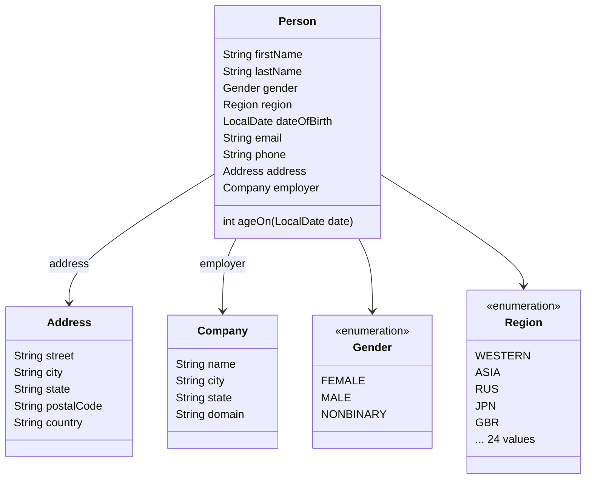

# faux-person

A Java 17 library and command-line tool that generate random, realistic people
for tests, demos and seed data. Each person has a name, gender, date of birth,
email, phone, US street address and employer, and the fields agree with each
other: the email is built from the name at the employer's domain, a woman with
a Russian surname gets the feminine form (Petrova, not Petrov), and the age
fits the date of birth. Surnames come up about as often as they do in real life:
about one South Korean in five is a Kim, and so is about one generated one.

Give it a seed and you get the same people every time, so a failing test can
be replayed exactly. Birth dates count back from today, so fix the date too
(`--today` on the command line, `.clock(...)` in Java) when you need the same
birth dates on another day. It has no runtime dependencies.

```text
$ ./faux-person.sh -n 3 --seed 42 --today 2026-11-20
Walter Joensuu (male, 46) <walter.joensuu6@iff.com> (545) 555-0151, 2925 Florence Ave, Las Vegas, NV 89120, works at International Flavors & Fragrances
Yusaku Kobayashi (male, 42) <yusaku.kobayashi41@up.com> (486) 555-0121, 3661 26th Ave, Brooklyn, NY 11214, works at Union Pacific Corporation
Ilia Martynova (female, 72) <ilia.martynova57@comtech.com> (235) 555-0144, 9172 Lambach Ln, Louisville, KY 40220, works at Comtech
```

> **Don't send anything to a generated person.** Emails use real company
> domains and addresses use real streets, so a generated email or address can
> belong to someone real. Phone numbers are always in the 555-0100 to 555-0199
> range, which is reserved for fiction.

## The model



*Figure: a `Person` holds a `Gender`, a `Region`, an `Address` and an employer
`Company`. All five types are in `org.tauasa.apps.faux.model`. `Person`,
`Address` and `Company` are immutable records, and `Gender` and `Region` are
enums. `PersonGenerator`, in `org.tauasa.apps.faux`, creates people.*

| Type | What it holds |
|---|---|
| `Person` | Name, gender, the region the names came from, date of birth, email, phone, address and employer. There's no age field, because a stored age goes stale: call `ageOn(date)` |
| `Address` | Street with house number (`2304 Eileen Ave`), city, two-letter state, five-digit ZIP, and country, always `US` |
| `Company` | A real US company: name, headquarters city and state, and web domain. It supplies the email domain |
| `Gender` | `FEMALE`, `MALE` or `NONBINARY` |
| `Region` | Where the names come from, in 24 values. Three broad ones: `WESTERN` (the Americas, Europe, Australia, New Zealand), `ASIA` (East, South and Southeast Asia) and `RUS` (Russia and the former Soviet Union). Three African: `NAF`, `CAF`, `SAF` (North, Central and Southern Africa). The rest are countries, by ISO code: `ROK` (South Korea), `JPN`, `PHL`, `VNM`, `THA`, `MEX`, `BRA`, `IRN`, `PSE`, `GBR`, `FRA`, `ESP`, `PRT`, `GRC`, `NOR`, `SWE`, `FIN`. The odd one out is `HEB`, which holds Hebrew names, from Israeli citizens |

Every record rejects `null` fields.

## Use it in a Java project

It isn't on Maven Central yet. Install it into your local Maven repository:

```bash
git clone https://github.com/tauasa/faux-person.git
cd faux-person
mvn install
```

Then add it to your project, usually in test scope:

```xml
<dependency>
  <groupId>org.tauasa.apps</groupId>
  <artifactId>faux-person</artifactId>
  <version>0.1.0</version>
  <scope>test</scope>
</dependency>
```

Generate people:

```java
import java.time.LocalDate;
import java.util.List;
import org.tauasa.apps.faux.PersonGenerator;
import org.tauasa.apps.faux.model.Person;
import org.tauasa.apps.faux.model.Region;

PersonGenerator gen = PersonGenerator.builder()
        .seed(42)                    // optional: the same seed gives the same people
        .region(Region.ASIA)         // optional: default picks a region per person
        .ageRange(25, 40)            // optional: default 18 to 90, inclusive
        .genderWeights(50, 50, 0)    // optional: FEMALE, MALE, NONBINARY (default 49, 49, 2)
        .build();

Person p = gen.next();
List<Person> team = gen.next(20);
List<Person> adults = gen.stream().filter(x -> x.ageOn(LocalDate.now()) >= 21).limit(100).toList();
```

To replay a failure, log `gen.seed()` and pass it back to `.seed(...)`. That
works even if you didn't set a seed, because the generator reports the random
one it picked. Pass `.clock(Clock.fixed(...))` too if a test checks ages, so
"today" doesn't move.

A generator isn't thread-safe. Give each thread its own with `gen.split()`,
which keeps the settings and starts a separate sequence you can replay.
Splitting draws from the parent, so it changes the parent's later people too:
to replay a run, call `split()` at the same points.

`build()` throws `IllegalArgumentException` if the age range falls outside
0 to 120 or is reversed, or if the gender weights are negative or all zero.

### Quick lists

For a list in one line, use a static method. It uses the defaults (ages 18 to
90, gender weights 49/49/2, today's date) and throws
`IllegalArgumentException` for a negative count. There's one method for every
region, named for its people, and three general ones:

```java
List<Person> anyone    = PersonGenerator.generateListOfRandomPeople(10);
List<Person> world     = PersonGenerator.generateListOfRandomPeopleFromAroundTheWorld(5, 20); // 5 to 20 people
List<Person> mexicans  = PersonGenerator.generateListOfRandomPeople(10, Region.MEX);
List<Person> americans = PersonGenerator.generateListOfRandomAmericans(10);  // WESTERN names
List<Person> koreans   = PersonGenerator.generateListOfRandomKoreans(10);    // ROK
```

The rest follow the same pattern: `Asians`, `Russians`, `Japanese`, `Filipinos`,
`Vietnamese`, `Thais`, `Mexicans`, `Brazilians`, `Iranians`, `Israelis` (`HEB`),
`Palestinians`, `NorthAfricans`, `CentralAfricans`, `SouthernAfricans`,
`Britons`, `French`, `Spaniards`, `Portuguese`, `Greeks`, `Norwegians`,
`Swedes` and `Finns`. There's no US-only region, so `Americans` draws from
`WESTERN`, which also covers Europe and Australia. Each call picks a new random
seed, so you can't replay its people. Use the builder when you need a seed,
an age range or a fixed date.

## Use the command line

`faux-person.sh` builds the jar with Maven the first time you run it, and again
whenever `pom.xml` or anything under `src/` is newer than the jar, then runs the
CLI. People go to stdout, or to a file with `-o`. The seed in use
always goes to stderr, so it never ends up in your output.

```bash
./faux-person.sh                                   # 10 people to stdout
./faux-person.sh -n 5 --seed 42 --today 2026-11-20 # the same 5 people, birth dates too, every day
./faux-person.sh -n 1000 -f json -o people.json    # 1,000 people to a file, as JSON
./faux-person.sh -n 200 -r rus -f pipe > rus.txt   # or redirect stdout yourself
./faux-person.sh -n 50 --min-age 65 --max-age 90 | grep ', FL '
```

| Option | Does | Default |
|---|---|---|
| `-o, --output FILE` | Write to `FILE` instead of stdout. A failed run leaves no file behind | stdout |
| `--rebuild` | Rebuild the jar first, even if it looks up to date | |
| `-n, --count N` | How many people | 10 |
| `-s, --seed S` | Seed, to get the same people again | random |
| `-r, --region R` | Any region in lowercase (`western`, `jpn`, `naf`, …), or `mixed`. `--help` lists all 24 | `mixed` |
| `--min-age N`, `--max-age N` | Youngest and oldest age | 18, 90 |
| `--today DATE` | The date ages are counted from, as `YYYY-MM-DD`. With `--seed`, it gives the same birth dates on any day. Another date changes only the birth dates and ages | today |
| `-f, --format F` | `text`, `pipe` or `json` | `text` |
| `-h, --help` | Show the options | |

`-o` and `--rebuild` belong to the script. Every other option is passed to the
CLI. Set `JAVA_OPTS` to give the JVM options. Without the script, run the jar
directly:

```bash
mvn package
java -jar target/faux-person-0.1.0.jar -n 5 -f json
```

`pipe` prints a header row and then 13 `|`-separated columns. This example
came from `--seed 42 --today 2026-11-20`, and the JSON one below from the same
plus `-r asia`:

```text
first|last|gender|region|dob|age|email|phone|street|city|state|zip|employer
Walter|Joensuu|MALE|FIN|1980-04-04|46|walter.joensuu6@iff.com|(545) 555-0151|2925 Florence Ave|Las Vegas|NV|89120|International Flavors & Fragrances
```

`json` prints one array, with each person on its own line (wrapped here to
fit):

```json
[
  {"firstName":"Hiroshi","lastName":"Zhang","gender":"MALE","region":"ASIA","dateOfBirth":"1974-01-22","age":52,
   "email":"hiroshi.zhang@disney.com","phone":"(849) 555-0148",
   "address":{"street":"761 Rosemary St","city":"Commerce City","state":"CO","postalCode":"80022","country":"US"},
   "employer":{"name":"The Walt Disney Company","city":"Burbank","state":"CA","domain":"disney.com"}}
]
```

When an argument is bad, the CLI names the problem, prints the options, and
exits with code 2.

## Where the data comes from

53 bundled files in `src/main/resources/org/tauasa/apps/faux/data/`, all
UTF-8 and NFC-normalized, built on 2026-11-19 and 2026-11-20:

| Data | How many | Source |
|---|---|---|
| First names and surnames for each of the 24 regions | Up to 1,200 per file. Shorter where Wikidata has fewer people, or the country has fewer names: Vietnamese (95 first names), South Korean surnames (123), Palestinian (342 and 188) | Wikidata (CC0), ranked by how many people of each citizenship carry them. Each surname also carries that count as its weight (`Kim|6766`), and surnames are drawn in proportion to it |
| South Korean names in Hangul, with romanization | 1,200 first names, 118 surnames | Wikidata. Bundled for later use: the generator doesn't read them yet |
| US companies with headquarters and domain | 1,500 | Wikidata: by revenue, then NYSE- and Nasdaq-listed companies by employee count |
| US streets with city, state and ZIP | 1,500, 30 per state | US Census TIGER/Line 2024 (public domain) |
| US cities with state and ZIP | 1,250, 25 per state | GeoNames (CC BY 4.0). Bundled for later use: addresses come from the streets file |

`NOTICE` gives the full attribution. [`tools/data/`](tools/data/) has the
scripts that rebuild the files. [SPEC.md](SPEC.md) explains how each field is
generated and lists the data's known gaps:
- The company list doesn't include every Fortune 500 member. Chevron is one
  that's missing.
- Within a region, the first name and surname can come from different
  countries.

## Build and test

```bash
mvn verify
```

This compiles the code and runs the tests. The tests cover reproducibility,
age bounds, emails, phones, addresses, how region and gender pick names, that
surnames come up in proportion to their weights, the size and shape of every
data file, that every data file is clean UTF-8 in NFC, that every region has its
own quick-list method, and the CLI. The build also produces the sources and
javadoc jars, and fails if anyone adds a runtime dependency.

## License

MIT License, in [LICENSE](LICENSE). The bundled GeoNames data is CC BY 4.0,
and [NOTICE](NOTICE) gives its attribution. Both files ship inside the jar
under `META-INF/`.

To publish a release to Maven Central, follow [RELEASING.md](RELEASING.md).
